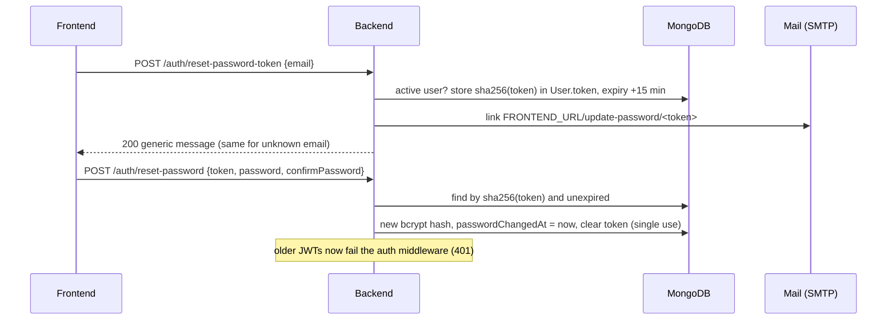
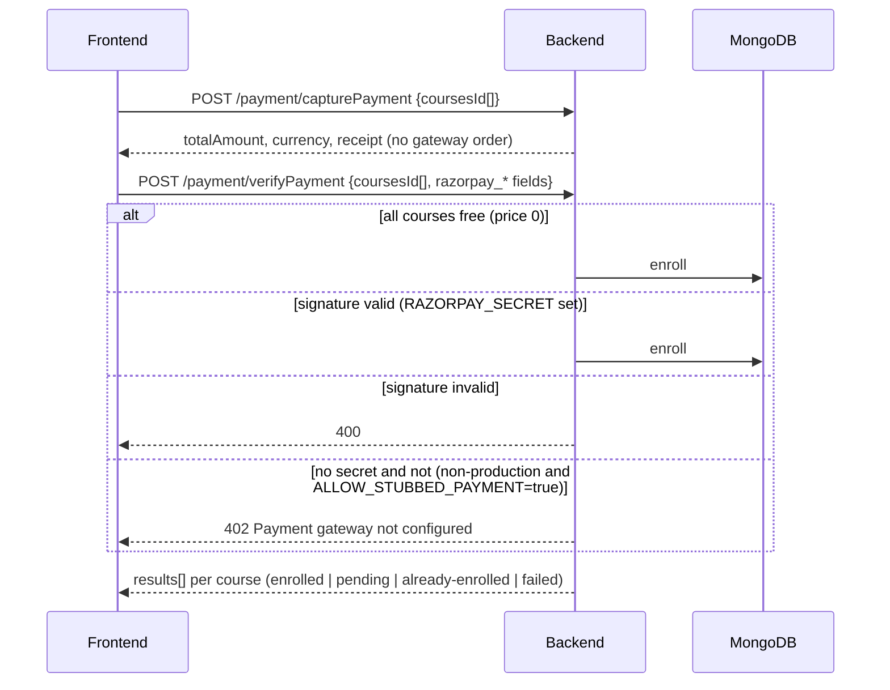

# System Design Document (SDD)

## 1. Introduction

Design of the ClzMate system as implemented: components, data flow, and module interactions. Facts are taken from the code; areas not implemented are marked.

## 2. System Architecture

Client-server monolith:

- **Frontend**: React 18 + Vite SPA (JavaScript). Runs in the browser, talks to the backend over REST.
- **Backend**: single Express 5 process (port 5000 default), Mongoose over MongoDB. `src/app.js` exports `createApp()` (middleware + routes, no I/O); `server.js` validates security config, connects MongoDB, configures Cloudinary and then listens. Business logic lives in controllers with helpers in `src/utils`; there is no service layer.
- **Backup service** (`backup/`): independent Node.js process, not called by the app. Dumps MongoDB collections, uploads to Google Drive, exposes its own API-key-protected REST API.

## 3. System Components

### 3.1 Frontend

- React 18.2, Vite 7, React Router DOM 7 (all pages lazy-loaded), Redux Toolkit (slices: `auth`, `profile`, `course`, `cart`, `sidebar`, `classroom`), Tailwind CSS 4, Axios, react-hook-form, react-hot-toast, react-icons.
- Layers: `entities/` (Redux slices and API thunks per domain), `features/` (UI blocks), `pages/`, `shared/`, `widgets/`.
- All HTTP goes through `shared/services/api/apiConnector.js`, which sends `Authorization: Bearer <token>`. Endpoint URLs are constants in `app/config/apis.js`; the base URL is `VITE_APP_BASE_URL`.
- Route guards: `ProtectedRoute` (token required, else `/login`), `OpenRoute` (logged-in users go to `/dashboard`), and `RoleRoute allowedRoles={[...]}` on every role-specific route (no token -> `/login`; profile not loaded -> spinner; wrong role -> `/dashboard`, which `RedirectToRole` sends to the role's home). The backend remains the authority.
- Response interceptor: a 401 whose message contains `token`, `missing`, `decoding` or `unauthorized` (outside `/login`) clears `token`/`user` from localStorage and redirects to `/login`. A 403 never logs the user out. Backend 401 messages "Account not found or deactivated" and "Session expired after password change..." contain none of those words, so they do not trigger the automatic logout.

### 3.2 Backend

- Express 5, Mongoose 8, `jsonwebtoken`, `bcrypt`, `helmet`, `express-rate-limit`, `express-fileupload`, `cookie-parser`, `cors`, `nodemailer`, `cloudinary`.
- Routes under `/api/v1`: `auth`, `profile`, `payment`, `course`, `admin`, `cart`, `student`, `site`, `classroom`, `reach` (contact).
- Controllers (18): auth, resetPassword, user, profile, course, section, subSection, category, courseProgress, ratingAndReview, cart, student, stats, asset, payments, classroom, classroomFeature, contact.
- Shared helpers: `utils/classroomAccess.js` (classroom roles, context loaders, `HttpError`), `courseAccess.js` (ownership), `enrollment.js` (enroll/request logic), `courseCleanup.js` and `userCleanup.js` (cascading deletes), `validators.js`, `passwordPolicy.js`.
- Auth: `auth` extracts the token (`Authorization` header, then cookie `token`, then `req.body.token`), verifies it, **loads the user** (missing or `active: false` -> 401; token `iat` older than `passwordChangedAt` -> 401) and sets `req.user = { id, email, accountType, approved }`. Role guards `isStudent`/`isInstructor`/`isAdmin` return **403**; `isInstructor` also requires `approved`.

### 3.3 Database

MongoDB via Mongoose, 19 models (see document 7). Domain trees:

- Course -> Section -> SubSection; CourseProgress per user/course; Note; RatingAndReview; Category.
- Classroom -> Topic (embedded `items[]`) -> Assignment -> Submission; Topic -> Quiz (embedded `screens[]`) -> Attempt; Announcement per Classroom.
- `Message` and `ClassroomSession` exist but are not used by any code.

### 3.4 External Services

| Service | Use | Status |
| :--- | :--- | :--- |
| Cloudinary | Uploads (`type: "authenticated"`); access through signed URLs from `POST /course/getAssetUrl`. | Used |
| Nodemailer (Gmail service or custom SMTP) | OTP, password reset, enrollment, payment and contact emails. `mailSender` returns `null` on failure instead of throwing. | Used |
| Razorpay | Payment signature verification only (HMAC with `RAZORPAY_SECRET`, no SDK). No order creation. | Partial |
| Google Drive | Backups (backup service only). | Used by `backup/` |

## 4. Data Flow

### 4.1 Signup, OTP verification and Login

```mermaid
sequenceDiagram
    participant F as Frontend
    participant B as Backend
    participant D as MongoDB
    participant M as Mail (SMTP)

    F->>B: POST /auth/signup (Student|Instructor, password 8-72)
    B->>D: Create Profile + unverified User (Instructor: approved=false)
    B-->>F: 201
    F->>B: POST /auth/sendotp
    B->>D: latest OTP < 60 s old? -> 429
    B->>M: send 6-digit code (failure -> 502, nothing stored)
    B->>D: delete old OTPs, store HMAC(email:otp) as otpHash (TTL 5 min)
    F->>B: POST /auth/verifyotp {email, otp}
    B->>D: compare hash; wrong -> attempts+1 (5 attempts -> OTPs deleted)
    B->>D: User.verified = true, delete OTPs
    F->>B: POST /auth/login
    B->>D: find user, bcrypt compare (dummy hash if unknown)
    B-->>F: 401 Invalid credentials | 403 unverified/deactivated | JWT + httpOnly cookie
```

Re-signing up with the email of an unverified user overwrites that user's name, password and role; a verified email returns 409. The frontend reacts to a login 403 "Please verify your email" by requesting a new OTP.

### 4.2 Password reset



### 4.3 Course Enrollment

All paths end in `utils/enrollment.js`.



The current frontend (`buyCourse`) skips `capturePayment` and posts only `{ coursesId, requiresApproval }` to `verifyPayment`, so from the UI free courses enroll and paid courses receive the 402 (unless the backend runs non-production with `ALLOW_STUBBED_PAYMENT=true`).

Per course: `requiresApproval` creates a Pending request (and mails the instructor); otherwise `completeEnrollment` atomically adds the student (`$ne` guard prevents double enrollment), creates `CourseProgress`, updates `User.courses`, and sends an email.

**Approval path** (`requiresApproval = true`)

```mermaid
sequenceDiagram
    participant S as Student
    participant I as Instructor
    participant B as Backend
    participant D as MongoDB

    S->>B: POST /course/requestEnrollment
    B->>D: push Pending request (or re-open a rejected one)
    I->>B: GET /course/enrollmentRequests/:courseId
    I->>B: POST /course/enrollmentRequests/:courseId/:requestId/respond {action: approve|reject, note}
    B->>D: set Approved/Rejected (409 if already answered); approve -> completeEnrollment
    S->>B: GET /course/enrollment-requests
```

### 4.4 Classroom Work

1. Approved instructor `POST /classroom/create` (invite code generated, creator is owner); any user `POST /classroom/join`.
2. Staff (owner, coInstructor, admin) create topics, items, assignments, quizzes. Members see published and targeted ones only.
3. Student member `POST /classroom/assignments/:id/submit` (403 for staff, non-members, untargeted, locked, after due date, or once graded). Staff grade with `PATCH .../submissions/:submissionId`.
4. Member `POST /classroom/quizzes/:quizId/attempts` with `{answers:[{screenId, provided, timeTaken}], finish}`. The server grades each screen, ignores unknown or repeated screens, caps `timeTaken`, and keeps one attempt per user. `GET .../leaderboard`.

## 5. Module Interactions

### 5.1 Frontend-Backend

JSON over HTTPS. Responses follow `{ success, message?, data? }`; some controllers add siblings (`token`, `user`, `courses`, `averageRating`, `updatedCourseDetails`) so payload keys still vary. Errors are `{ success: false, message }`. 429 is returned by rate limiters, 404 for unknown routes (`Route not found: METHOD path`), 400 for malformed JSON.

### 5.2 Backend-Database

Mongoose models created through `utils/createModel`. `server.js` awaits `connectDB()` (10 s server-selection timeout) before listening and exits 1 on failure; Cloudinary is configured synchronously afterwards. SIGTERM/SIGINT close the HTTP server and exit 0.

## 6. Design Patterns

- Route -> controller -> Mongoose model (MVC-like; no service layer). Cross-cutting concerns are middleware: `sanitizeRequest` (strips `$`-prefixed and dotted keys from body, query, params), `uploadGuard`, rate limiters, `notFoundHandler`, `errorHandler`.
- Ownership and role logic in `courseAccess.js` and `classroomAccess.js`; controllers call `assertMember`/`assertStaff` or `canManageCourse`.
- Redux Toolkit slices with thunks in `entities/*`; cart and auth token are mirrored to `localStorage` manually.
