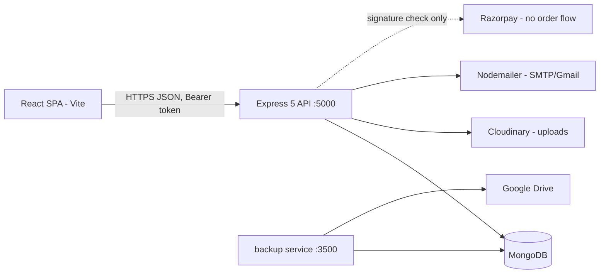

# Architecture & Technical Specifications

## 1. Introduction

Architecture and technical specification of ClzMate as implemented. Items not present in code are labelled as future ideas.

## 2. System Architecture

Client-server. A React SPA (browser) consumes a REST API served by a single Express process. Supporting systems: MongoDB, Cloudinary, an SMTP provider, and an independent backup service.

- The backend is a monolith (no microservices, no service mesh). Frontend and backend deploy independently.
- The backup service reads MongoDB directly; it does not go through the API.

### 2.1 Backend startup and middleware order

`backend/server.js` (entry point):

1. `dotenv` and `dotenv-flow` configuration
2. `assertSecurityConfig()`: `JWT_SECRET` shorter than 32 characters (production) throws, shorter than 16 (development) only warns; production also requires `CORS_ALLOWED_ORIGINS`
3. `await connectDB()` (fail-fast: logs and exits 1 if `DATABASE_URL` is unset or MongoDB is unreachable within 10 s), then `cloudinaryConnect()`
4. `createApp().listen(PORT || 5000)`; `SIGTERM`/`SIGINT` close the server and exit 0

`backend/src/app.js` `createApp()` (no I/O, importable by tests), in order:

1. `trust proxy` = 1 when `NODE_ENV=production`
2. `helmet()`
3. `cors` with an Origin callback (`CORS_ALLOWED_ORIGINS`, `CORS_BLOCK_NO_ORIGIN`, `credentials: true`)
4. Origin allow-list check: a request carrying an `Origin` not in the list gets 403 `{ success: false, message: "CORS origin not allowed" }`
5. `globalLimiter`: 600 requests per 15 minutes per IP (429 JSON). Disabled when `NODE_ENV=test`
6. `express.json({ limit: "1mb" })`
7. `cookie-parser`
8. `express-fileupload` (`useTempFiles`, `tempFileDir: os.tmpdir()`, `limits.fileSize = MAX_UPLOAD_MB` (default 200) MB, `abortOnLimit`)
9. `uploadGuard`: 400 for empty/unnamed files, blocked extensions (`.exe .bat .cmd .com .msi .dll .scr .sh .ps1 .vbs .jar .php .apk .dmg`), and for fields named `thumbnail`, `thumbnailImage`, `profileImage` or `image` anything that is not PNG/JPEG/GIF/WebP/AVIF (SVG rejected; both mimetype and extension are checked)
10. `sanitizeRequest`: deletes keys starting with `$` or containing `.` from `req.body`, `req.query`, `req.params`
11. Route mounts under `/api/v1`: `auth`, `profile`, `payment`, `course`, `admin`, `cart`, `student`, `site`, `classroom`, `reach`
12. `GET /` returns `{ success: true, message: "ClzMate API" }`
13. `notFoundHandler` (JSON 404) and `errorHandler`: `CastError`, `ValidationError` and malformed JSON become 400; status >= 500 returns the generic "Internal server error" (details are logged, never returned)

Per-route guards (`auth`, `isStudent`, `isInstructor`, `isAdmin`) are applied in each route file. Additional limiters: `authLimiter` (20 per 15 minutes) on signup, login, sendotp, verifyotp, reset-password-token and reset-password; a dedicated limiter (5 per 15 minutes) on `POST /reach/contact`.

## 3. Technology Stack

### 3.1 Frontend

| Technology | Version (package.json) | Use |
| :--- | :--- | :--- |
| React | ^18.2 | UI |
| Vite | ^7.1.9 | Build and dev server |
| Redux Toolkit / react-redux | ^2.8.2 / ^9.2 | State (6 slices) |
| React Router DOM | ^7.8 | Routing, lazy-loaded pages |
| Tailwind CSS | ^4.1.11 (`@tailwindcss/vite`) | Styling |
| Axios | ^1.11 | HTTP via one shared instance |
| react-hook-form, react-hot-toast, react-icons, chart.js, framer-motion, swiper, excalidraw | see package.json | Forms, toasts, icons, charts, motion, carousels, whiteboard |

JavaScript only. ESLint 9 with zero-warning tolerance (`npm run lint`).

### 3.2 Backend

| Technology | Version | Use |
| :--- | :--- | :--- |
| Node.js | >= 18 (required by Express 5) | Runtime |
| Express | ^5.1 | HTTP framework |
| Mongoose / MongoDB | ^8.18 | Persistence (19 models) |
| jsonwebtoken, bcrypt | ^9, ^6 | Auth, password hashing |
| helmet, express-rate-limit | ^8.3, ^8.7 | Security headers, rate limiting |
| cloudinary, express-fileupload | ^2.7, ^1.5 | File uploads |
| nodemailer | ^7 | Email |
| mongodb-memory-server, supertest (dev) | ^11.3, ^7.3 | Test suite (`npm test`, built-in `node:test`) |

### 3.3 Backup service

Node.js, `mongodb` driver, EJSON + tar.gz, Google Drive OAuth2, `node-cron` (`0 */12 * * *`, timezone Asia/Colombo), own REST API (`/health` public; `/backups`, `/backup`, `/restore` require `BACKUP_API_KEY`, at least 24 characters, sent as `x-api-key` or Bearer; POST routes limited to 10 per minute per IP). Binds to `HOST` (default `127.0.0.1`), port 3500. The HTTP server refuses to start without a valid key; `npm run once` does not need it.

## 4. Component Interfaces (API)

Mount prefixes under `/api/v1`: `/auth`, `/profile`, `/payment`, `/course`, `/admin`, `/cart`, `/student`, `/site`, `/classroom`, `/reach`. Full endpoint list: document 6.

## 5. External Integrations

| Integration | Detail |
| :--- | :--- |
| Cloudinary | `utils/fileUploader.js`; resources stored with `type: "authenticated"`; model records keep `publicId` and `resourceType` for deletion; viewing requires `POST /course/getAssetUrl`. |
| Nodemailer | `utils/mailSender.js`; `MAIL_SERVICE=gmail` selects the Gmail service, otherwise custom SMTP (`MAIL_HOST`, `MAIL_PORT`, `MAIL_SECURE`). Returns `null` on failure (callers decide whether that is fatal: `sendOTP` answers 502). Templates in `src/mail/templates`. |
| Razorpay | `controllers/payments.js` verifies `HMAC-SHA256(order_id|payment_id)` against `RAZORPAY_SECRET` with a timing-safe compare. No SDK, no order creation (`config/rajorpay.js` is a commented-out leftover). |
| Google Drive | Backup service only. |

## 6. Scalability Considerations

Current state: a single process; JWTs are stateless (but the auth middleware reads the user from MongoDB on every request), so more instances behind a load balancer are possible, but uploads use the OS temp directory, rate-limit counters and the 60 s site-stats cache are per-process memory, and there is no shared cache. Nothing below is implemented:

- Redis caching: future idea only.
- Microservices split: future idea only.
- MongoDB sharding, CDN for static assets: future ideas only.
- No performance measurements exist; no performance claims are made.
