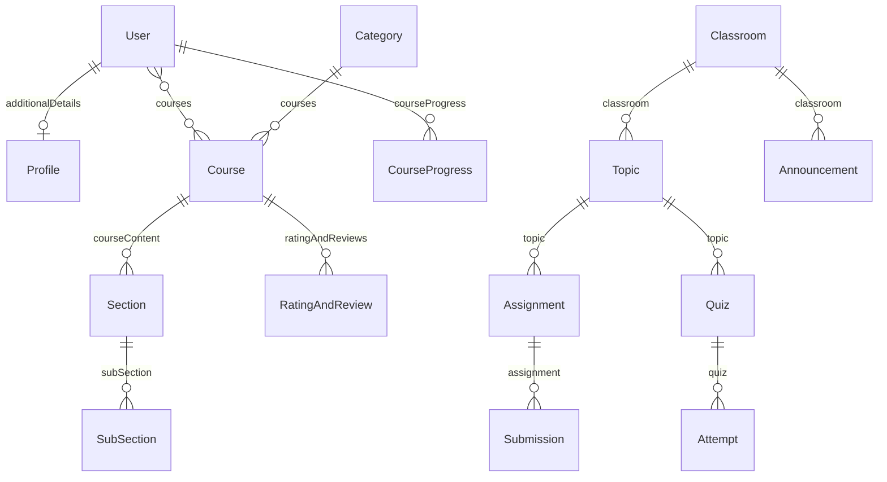

# Database Schema

## 1. Introduction

All 19 Mongoose models in `backend/src/models`, verified against the schema files. Models are created through `utils/createModel`. Mongoose pluralizes model names for collections (e.g. `User` -> `users`).

## 2. Database

MongoDB (Atlas in current use), connected through Mongoose 8 with `DATABASE_URL` (the server connects before listening and exits if it cannot). Indexes listed per model are the ones declared in schemas; every collection also has the default `_id` index. There are no migrations: Mongoose builds declared indexes on startup, so adding a unique index to a collection that already holds duplicates fails (clean the data first).

## 3. Collections

Notation: `Type`, `req` = required, `ref` = ObjectId reference, `[]` = array. `meta` = `{ createdAt: Date, updatedAt: Date }` (defaults `Date.now`, not auto-maintained).

### 3.1 Identity

**User** (`timestamps: true`)

| Field | Type | Notes |
| :--- | :--- | :--- |
| preferredName | String, req, trim | |
| firstName, lastName | String, trim | |
| email | String, req, trim, **lowercase, unique** | Unique index; controllers also normalize to lowercase |
| password | String, req | bcrypt hash |
| accountType | String enum `Admin`, `Instructor`, `Student`, req | Public signup only allows `Student` and `Instructor` |
| active | Boolean, default true | `false` blocks login and makes the `auth` middleware return 401 |
| approved | Boolean, default true | Set false by signup for Instructors; `isInstructor` returns 403 until an admin sets it true |
| additionalDetails | ref Profile | |
| courses | [ref Course] | Enrolled courses |
| cart | [ref Course] | |
| image | String, default "" | |
| token | String, `select: false`, sparse index | **Holds the sha256 hash of the password-reset token** (not a login token); cleared after a successful reset |
| resetPasswordTokenExpires | Date, `select: false` | Reset token expiry (15 min) |
| passwordChangedAt | Date | Set on password change/reset; tokens with `iat` before it are rejected (401) |
| verified | Boolean, default false | |
| courseProgress | [ref CourseProgress] | |

Contact number is stored in Profile.

**Profile**: gender String; dateOfBirth String; about String (trim); contactNumber String (trim); protectMe Boolean default false.

**OTP**: email String req (lowercase, trim, indexed); otpHash String req (HMAC-SHA256 of `email:code` keyed by `JWT_SECRET`; the code itself is never stored); attempts Number default 0 (5 wrong tries invalidate it); createdAt Date `default: Date.now` (function reference) with `expires: 300` (TTL index, 5 minutes). Documents are created explicitly by `auth.sendOTP` after the mail was sent, previous OTPs for the email are deleted first, and the document is deleted after successful verification. The model has no hooks. `OTP.OTP_TTL_SECONDS` is exported.

### 3.2 Course Domain

**Course**

| Field | Type | Notes |
| :--- | :--- | :--- |
| courseName, courseDescription, whatYouWillLearn | String | |
| instructor | ref User, req | |
| courseContent | [ref Section] | |
| ratingAndReviews | [ref RatingAndReview] | |
| price | Number, min 0 | `0` means free (enrolls without payment) |
| thumbnail | String | |
| category | ref Category | |
| tag | [String], req | |
| studentsEnrolled | [ref User] | |
| instructions | [String] | |
| features | `{ sandboxEnabled: Boolean=false, sandboxLanguage: String="javascript", notesEnabled: Boolean=true }` | |
| status | String enum `Draft`, `Published` | No default |
| createdAt, updatedAt | Date | Set manually |
| requiresApproval | Boolean, default false | |
| enrollmentRequests | [`{ user: ref User req, status: enum Pending/Approved/Rejected = Pending, requestedAt: Date, respondedAt: Date, responder: ref User, note: String }`] | Embedded subdocuments |

**Section**: sectionName String; subSection [ref SubSection, req].

**SubSection** (`timestamps: true`): title String (trim, default ""); timeDuration Number default 0; description String; supportMaterials [`{ url, publicId, originalName, mimeType: String; size: Number; resourceType: String; isMainVideo, isMainPdf, isMainHtml: Boolean=false }`]; externalVideoUrl String default null; createdAt Date default now; updatedAt Date.

**Category**: name String req; description String; courses [ref Course].

**CourseProgress**: courseID ref Course; userId ref User; completedVideos [ref SubSection].

**RatingAndReview**: user ref User req; rating **Number** req, min 1, max 5; review String req, maxlength 2000; course ref Course req, indexed. Unique compound index `{ user, course }` (one review per user per course).

**Note** (`timestamps: true`): userId ref User req; courseId ref Course req; sectionId ref Section; subSectionId ref SubSection; content String default "".

### 3.3 Classroom Domain

**Classroom**: title String req trim; description String; owner ref User req; inviteCode String req **unique**; members [`{ user: ref User req, role: enum Instructor/CoInstructor/Student/Guest = Student, addedAt: Date, temporaryUntil: Date }`]; coInstructors [ref User]; guests [ref User]; meta.

**Topic**: classroom ref Classroom req; title String req; description String; createdBy ref User req; status enum `draft`/`published` = draft; position Number = 0; items [Item]; assignmentsCount Number = 0; meta.
- Item (embedded): type enum `assignment`, `quiz`, `material`, `subsection`, `copied` (req); title String req; content String; link String; refId ObjectId default null; status enum `draft`/`published` = draft; position Number; attachments [`{ url, publicId, originalName, mimeType: String; size: Number; resourceType: String }`]; meta.

**Assignment**: topic ref Topic req; title String req; instructions String; createdBy ref User req; dueDate Date default null; points Number = 100; attachments [`{ url, publicId, originalName, mimeType, resourceType: String; size: Number }`]; publish Boolean = false; assigneeType enum `all`/`selected` = all; assignees [ref User]; classesAssigned [ref Classroom]; references String; lockSubmissions Boolean = false; createdAt, updatedAt Date.

**Submission**: assignment ref Assignment req; student ref User req; content String; attachments [`{ url, publicId, originalName, mimeType: String; size: Number; resourceType: String }`]; submittedAt Date; grade Number default null; feedback String; gradedBy ref User; gradedAt Date.

**Quiz**: topic ref Topic req; title String req; description String; timeLimit Number = 0; shuffle Boolean = false; screens [Screen]; publish Boolean = false; createdBy ref User req; meta.
- Screen (embedded): type enum `multiple`, `truefalse`, `short`, `slider`, `poll`, `puzzle` (req); body String; options [`{ text: String, correct: Boolean=false }`]; properties `{ timeLimit: Number=0, points: Number=1, answerMode: enum single/multiple = single }`; position Number; status enum `draft`/`published` = draft; meta.

**Attempt**: quiz ref Quiz req; user ref User req (unique with `quiz`: one attempt per user per quiz); answers [`{ screenId: ObjectId req, provided: Mixed, correct: Boolean, points, basePoints, timeTaken, timeBonus: Number }`, no `_id`]; totalPoints Number; startedAt Date; finishedAt Date default null; meta.

**Announcement**: classroom ref Classroom req; author ref User req; title String req; body String; pinned Boolean = false; meta.

**ClassroomSession** (unused by code): classroom ref Classroom req; title String req; startAt, endAt Date req; externalUrl String default null; createdBy ref User req; createdAt Date.

**Message** (unused by code; no real-time layer exists): classroom ref Classroom req; from ref User req; toUser ref User default null; content String; attachments [`{ url, originalName }`]; createdAt Date.

## 4. Index Summary

| Collection | Declared indexes |
| :--- | :--- |
| User | **unique** `email`; sparse `token` |
| OTP | `email`; TTL on `createdAt` (300 s) |
| Classroom | **unique** `inviteCode`; `owner`; `members.user` |
| Topic | `{ classroom: 1, position: 1 }` |
| Assignment | `topic` |
| Submission | **unique** `{ assignment: 1, student: 1 }` |
| Quiz | `topic` |
| Attempt | **unique** `{ quiz: 1, user: 1 }` |
| Announcement | `{ classroom: 1, pinned: -1 }` |
| RatingAndReview | `course`; **unique** `{ user: 1, course: 1 }` |
| All others | `_id` only (e.g. `Note`, `CourseProgress`, `Course`) |

The unique indexes back race-safe behavior in the controllers: duplicate submission/attempt/review writes surface as MongoDB error 11000, which the classroom helpers map to 409.

## 5. Behavior Notes and Remaining Schema Gaps

- `Course.status` has no default; controllers set `Draft` or `Published`, and every public endpoint filters on `Published`.
- Deleting users and courses is done in application code (`utils/userCleanup.js`, `utils/courseCleanup.js`), not by database cascades; references are removed from Users, Categories, CourseProgress, Notes and reviews.
- Many dates use `Date.now` defaults with manual `updatedAt` maintenance (only `User`, `SubSection`, `Note` use `timestamps`).
- `Course.enrollmentRequests` is embedded; it is stripped from public and student-facing responses.
- No index on `Note.userId`/`courseId`, `CourseProgress.courseID`/`userId`, `Course.instructor` or `Course.status`.
